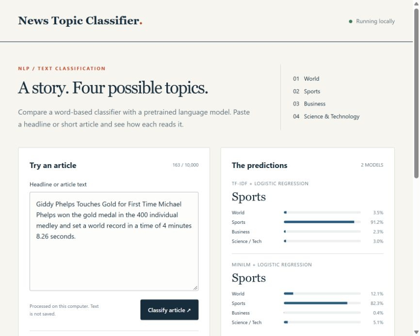
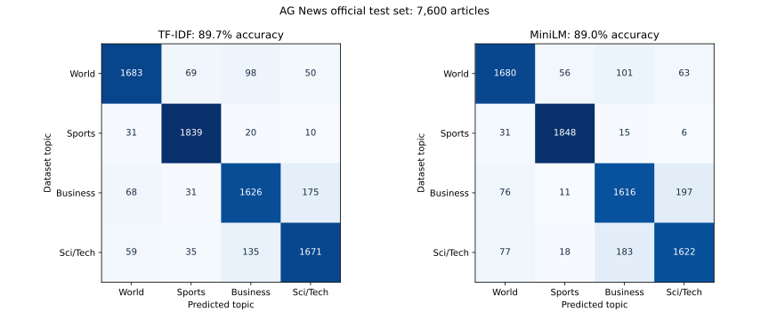

# News Topic Classifier

A local app that sorts English news into World, Sports, Business, or Science and Technology. Paste a headline or short article to compare two classifiers, or try an article from AG News.

This is a portfolio project covering text classification, model comparison and error analysis. It is useful as a small prototype for organising a news collection, rather than a finished editorial system.



## Methods

The baseline uses TF-IDF word features and logistic regression. It learns which words and pairs of words tend to occur in each topic.

The second method uses the pretrained `sentence-transformers/all-MiniLM-L6-v2` encoder to turn each article into a 384 dimensional representation, followed by logistic regression. The encoder is frozen: only the classifier is trained on AG News. It runs locally through ONNX Runtime, with no paid API or account required.

Both classifiers use the same training and validation articles. Regularisation is selected from C values of 1, 4 and 16 using validation macro F1. The test results are calculated after that selection, without refitting on validation or test articles.

## Data and evaluation

AG News contains published news headlines and descriptions, with four topic labels. The original files have 120,000 training articles and 7,600 test articles.

Before sampling, the pipeline removes 151 repeated training texts and 10 training texts that also appear in the official test file. Matching uses a hash of the combined, cleaned title and description. This catches exact matches, not related stories or paraphrases.

The recorded run samples a pool of 20,000 articles from the remaining training data, using a fixed seed and a stratified split. Of those, 16,000 train the classifiers and 4,000 select the settings. All 7,600 official test articles are retained, with 1,900 per topic. This is a comparison on a training subset, not a full corpus benchmark.

<table>
<tr><th>Method</th><th>Test accuracy</th><th>Macro F1</th></tr>
<tr><td>TF-IDF + logistic regression</td><td>89.72%</td><td>0.8969</td></tr>
<tr><td>MiniLM + logistic regression</td><td>89.03%</td><td>0.8901</td></tr>
</table>

The simpler classifier performed slightly better in this run. A pretrained encoder does not automatically improve a topic classifier. Macro F1 gives each topic equal weight when summarising precision and recall.



`reports/metrics.json` contains the settings, per topic results, confusion matrices and a paired bootstrap comparison. `reports/test_predictions.csv` records each test row's label, predictions and highest model scores. `reports/training_assignments.csv` records the selected training and validation rows. Row IDs refer to the original CSV files and start at 1. Labels in these reports are numbered 0 through 3 in the order World, Sports, Business, Science and Technology.

The app includes examples that MiniLM misclassified. One is test row 2891, a Sports article about the British Grand Prix that also discusses money and business decisions. MiniLM predicts Business, while the baseline predicts Sports. These examples show category overlap; the dataset label is not necessarily the only reasonable interpretation.

## Run locally

Use Python 3.11 or newer. From the project folder:

```powershell
py -3.12 -m venv .venv
.\.venv\Scripts\Activate.ps1
python -m pip install -e ".[dev]"
python -m news_topics.prepare
python -m news_topics.train
python -m uvicorn news_topics.api:app --host 127.0.0.1 --port 8000
```

Open http://127.0.0.1:8000 in your browser. The first preparation step downloads about 122 MB of dataset and encoder files, in addition to Python dependencies. Training runs on a CPU and takes several minutes depending on the computer. After preparation and training, the app works offline. Submitted text is processed locally and is not saved by the app.

The default training pool is 20,000 articles. To use all available training articles after overlap removal:

```powershell
python -m news_topics.train --train-limit 0
```

That produces a different experiment and replaces the saved reports and classifiers. Embeddings are cached to speed up repeated runs. Model weights and the complete dataset are downloaded locally, rather than stored in this repository.

## API

`POST /api/predict` accepts a JSON object with a `text` field and returns both topic predictions and the scores for all four topics. Text must contain something other than whitespace and cannot exceed 10,000 characters.

`GET /api/examples` returns articles from the downloaded test file, including recorded mistakes. `GET /api/evaluation` returns the saved results. `GET /api/health` checks whether both classifiers are loaded. Interactive API documentation is available at `/docs`.

If the models are missing, the app explains that preparation and training are needed. It does not download models automatically when a visitor opens the page. Start it from the project folder, or set `NEWS_PROJECT_ROOT` to that folder.

## Tests

```powershell
pytest -q
ruff check src tests
```

Offline tests use a small excerpt of the AG News training file, with original row IDs in `tests/fixtures/source.json`. They check split separation, prediction output, input validation and missing model handling. They are not used to report accuracy.

Once the local model files exist, integration tests also check that batching does not change the encoder output and that live predictions match the saved evaluation. Saved test predictions are checked against the reported accuracy and split assignments. GitHub Actions runs the offline tests and saved report checks; the two tests requiring downloaded model weights are skipped there.

## Limitations

AG News is a historical, balanced news dataset. Results do not establish how well the app handles current news, other languages, social media, or different topic distributions. Titles and descriptions are combined during training, so performance on headlines alone has not been measured separately.

Both models always choose one of the four topics, including for text outside those topics. Neither checks facts or determines whether a source is reliable. Scores are classifier probabilities without additional calibration, and should not be read as guaranteed certainty.

MiniLM reads at most 256 tokens, while the word model uses the submitted text up to the app's character limit. Long articles can therefore give the models different information. Source formatting artefacts remain in some AG News descriptions.

Exact text matching does not remove every related or near duplicate story. The pretrained encoder may also have encountered related material during pretraining; that has not been audited. A row bootstrap assumes independent observations and can understate uncertainty when news stories are related. This experiment uses one seed and a small settings search.

The interface is intended for local use and has no authentication or public hosting setup. Only load the joblib classifier files generated by your own training run, since loading untrusted model files can execute code.

## Sources and attribution

[AG News dataset documentation](https://github.com/mhjabreel/CharCnn_Keras/blob/master/data/ag_news_csv/readme.txt), assembled by Xiang Zhang from Antonio Gulli's news corpus, accompanies the benchmark introduced by Xiang Zhang, Junbo Zhao and Yann LeCun in 2015. The dataset documentation describes research and other noncommercial use. News text retains its original rights; the code licence does not relicense the articles.

[MiniLM model card](https://huggingface.co/sentence-transformers/all-MiniLM-L6-v2) documents the pretrained sentence encoder, released under Apache 2.0. The model's card is also downloaded alongside its weights.

`provenance.json` records the pinned dataset and model revisions, source URLs, download time and SHA256 checksums. Training checks those files before using them. Package versions for the recorded run are in the evaluation report.
